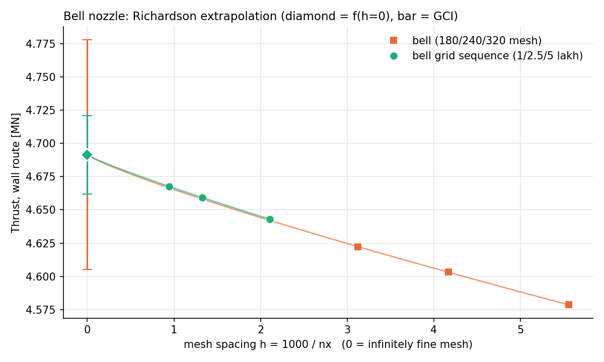

# Richardson extrapolation of the mesh study

This folder estimates what the 2-D solver ([`../../2D-Solver`](../../2D-Solver)) would give on an infinitely fine mesh, and how far the meshes of the grid independence study ([`..`](..)) are from that value.

It is part of the MachViz team project at Otto von Guericke University Magdeburg (team of 6). It applies the Richardson method from the bend-pipe exercise of our OpenFOAM course to the solver results. The calculation script and the Excel workbook were made with an AI coding assistant.

## Main result

Wall-pressure thrust of the bell nozzle (p0 = 30 bar, T0 = 3,000 K, throat 1.2 m, exit 3.0 m):

| Mesh | Cells | Wall thrust [MN] |
|---|---|---|
| 475×119×366 | 100,079 | 4.64304 |
| 752×188×579 | 250,228 | 4.65926 |
| 1060×265×815 | 496,875 | 4.66772 |
| Richardson (infinitely fine) | – | 4.6915 |

The 500k mesh is 0.51 % below the extrapolated value. Its uncertainty band (GCI) is 0.64 %, so the wall thrust is 4.69 MN ± 0.64 %. Three fine-study meshes (180×45×139, 240×60×185, 320×80×246) are refined independently of these and extrapolate to the same 4.6915 MN.



## How it is calculated

Three meshes of one family are used: fine (f1), medium (f2) and coarse (f3). In a family nx, ny and npl are all refined by the same factor, so nx alone measures the mesh size.

1. Mesh spacing: h = 1/nx.
2. Refinement ratios: r21 = nx1/nx2 and r32 = nx2/nx3.
3. Changes between meshes: e21 = f2 − f1 and e32 = f3 − f2.
4. Convergence check: R = e21/e32.
   - 0 < R < 1: the changes shrink as the mesh gets finer, so the method can be used.
   - R < 0 (oscillating) or R ≥ 1 (diverging): no extrapolation.
5. Order of convergence: p = ln(e32/e21)/ln r when r21 = r32 = r. When the ratios differ, p comes from a short iteration (Celik et al. 2008).
6. Extrapolated value: f(h=0) = f1 + (f1 − f2)/(r21^p − 1).
7. Uncertainty of the fine mesh: GCI = 1.25 × |(f1 − f2)/f1| / (r21^p − 1).
8. A result is trusted only when 0 < R < 1 and 0.5 ≤ p ≤ 3. The solver is first order, so p should be close to 1.

Steps 1 to 6 follow the bend-pipe exercise from our OpenFOAM course, which assumes equal ratios. The 100k/250k/500k meshes have unequal ratios (1.41 and 1.58). With the equal-ratio formula they would give p = 1.90 and 4.677 MN, which is too low, so `richardson.py` uses the general form for them. The workbook `Richardson_extrapolation_nozzle.xlsx` shows the equal-ratio steps with visible formulas, in the same layout as the bend-pipe sheet.

## Results

| Meshes | Wall thrust | p | GCI | Inlet mass flow |
|---|---|---|---|---|
| Bell, 100k / 250k / 500k | 4.6915 MN | 0.89 | 0.64 % | 2,392.2 kg/s |
| Bell, 180 / 240 / 320 | 4.6915 MN | 0.85 | 1.87 % | 2,399.4 kg/s |
| Cosine, 180 / 240 / 320 | 4.5843 MN | 0.77 | 2.11 % | 2,399.5 kg/s |
| Conical, 180 / 240 / 320 | 4.7048 MN | 0.55 | 2.91 % | 2,399.6 kg/s |
| Super-ellipse, 180 / 240 / 320 | 4.4375 MN | 2.16 | 1.30 % | 2,399.4 kg/s |

- Bell and conical differ by 0.3 % after extrapolation, less than their uncertainty. On the finest common mesh the bell is ahead (see the ranking in [`../README.md`](../README.md)), but the extrapolated values cannot separate the two. Cosine and super-ellipse stay lower by more than the uncertainty.
- `results.csv` also has exit-plane thrust, Isp, C_d and mass-averaged exit Mach. Several of them fail step 8 on the 180/240/320 meshes. Those runs stopped at 40,000 iterations with residuals between 10⁻⁴ and 8 × 10⁻², and for quantities that barely change between meshes the leftover iteration error is as large as the mesh effect.

## Input data

`input_data.csv` holds the 15 runs used. The values are copied unchanged from the summary files in this repository:
- the fine-study rows from `../<Profile>/fine_summary_all_levels.csv`;
- the 100k/250k/500k rows from `../Bell-500k-Cells/stage*_summary.csv` (iteration 20,000 for the 500k mesh).

Only the column names are shorter:

| input_data.csv | Summary column |
|---|---|
| thrust_wall_N | thrust.thrust_wall_integral_route_N |
| thrust_exit_plane_N | key.thrust_N |
| mass_flow_kg_s | key.mass_flow_inlet_kg_s |
| isp_s | key.specific_impulse_s |
| Cd | thrust.discharge_coefficient_Cd |
| exit_mach_mass_avg | key.exit_mass_averaged_mach |

180/240/320 is the only set in the fine study with equal ratios (240/180 = 320/240 = 4/3). The 100k/250k/500k meshes keep the same cell proportions (ny ≈ nx/4, npl ≈ 0.77 nx), so both are one refinement family.

## Run it

```
pip install -r requirements.txt
python richardson.py
```

This prints a worked example for the bell thrust, writes `results.csv` and redraws the plot.

## Files

| File | Content |
|---|---|
| `richardson.py` | The calculation, following steps 1 to 8 |
| `input_data.csv` | The 15 runs used |
| `results.csv` | Every set of meshes and every quantity: R, p, extrapolated value, error, GCI, trusted or not |
| `Richardson_extrapolation_nozzle.xlsx` | The equal-ratio calculation with visible formulas |
| `richardson_bell_thrust.png` | Bell thrust against mesh spacing |

## Limits

- Richardson extrapolation removes mesh error only. The solver is inviscid and first order, so there is no boundary layer, friction or separation, and a real nozzle would give less thrust.
- None of the runs reached the 10⁻⁵ residual target, so iteration error is mixed into the mesh error. Only the nozzle integrals (wall thrust, mass flow) give clean extrapolations.
- The results are not compared with experiments.

Reference: I. B. Celik et al., "Procedure for estimation and reporting of uncertainty due to discretization in CFD applications", ASME Journal of Fluids Engineering 130 (2008) 078001.
